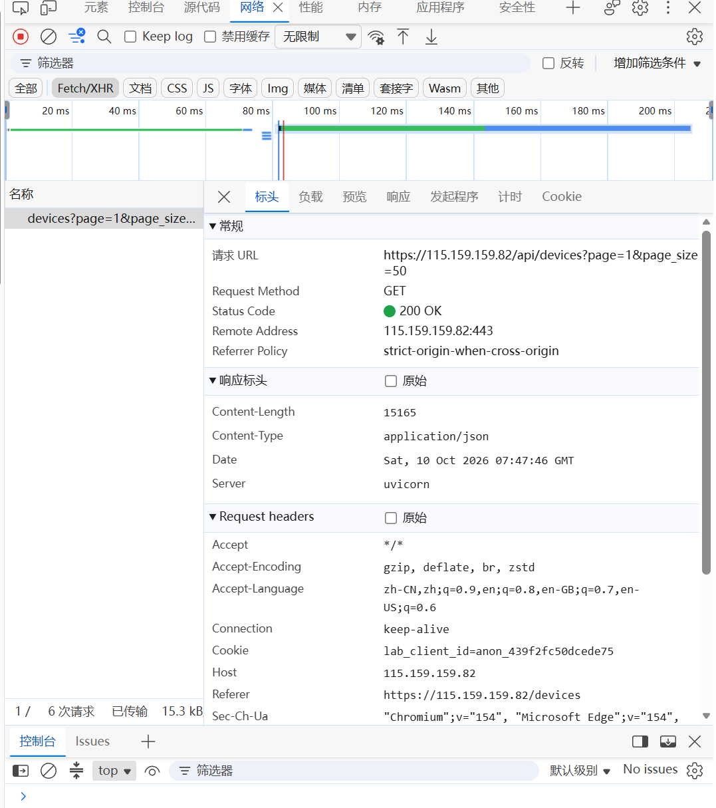
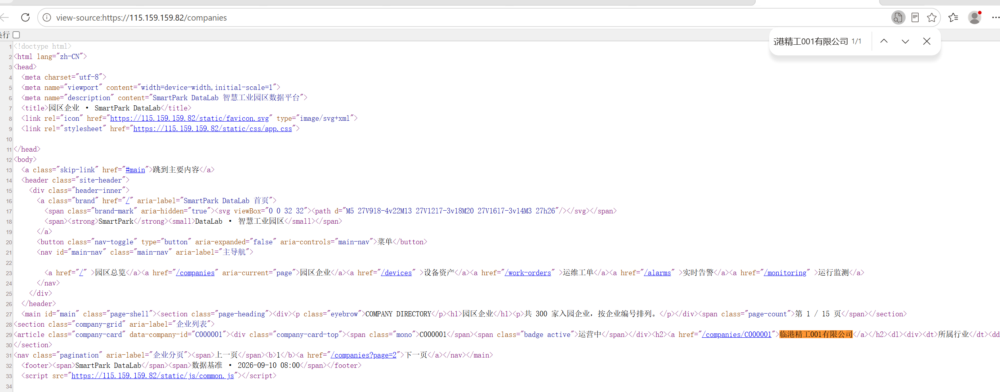
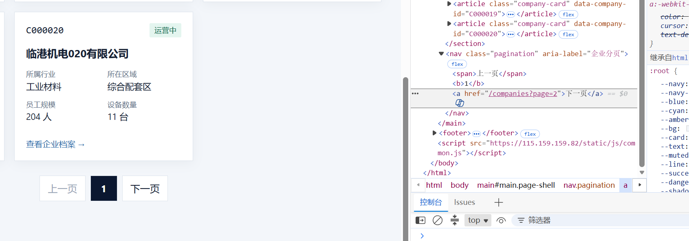
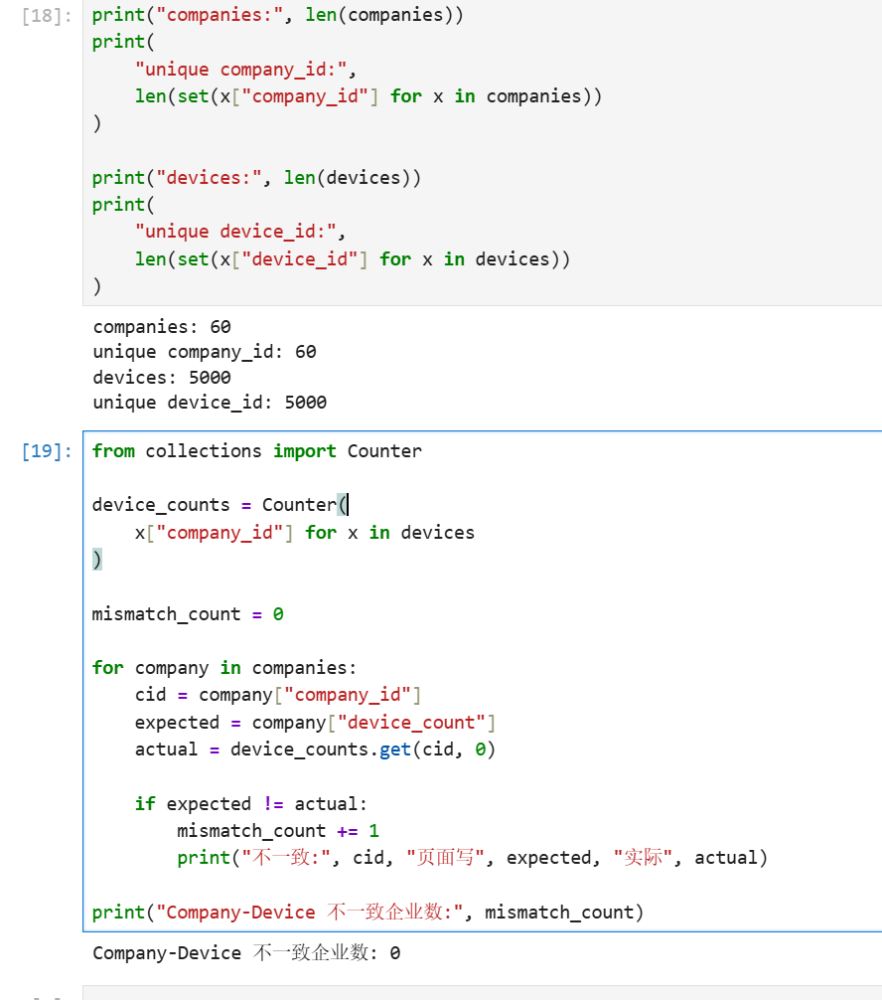

# Lab 1 实验报告

## 学生信息

- **姓名：** 陈梓轩
- **学号：** 112404260125
- **班级：** 数据1241
- **GitHub 用户名：** kl33313
- **仓库地址：** https://github.com/kl33313/bigdata-collection-labs-112404260125

> 文件位置：`lab01/REPORT.md`
> 完整代码保存在 `lab1_html_api.ipynb`。
> 本报告只填写关键发现、关键代码、结果和指定截图，未把整份 Notebook 复制进来。

---

# 任务 1：判断数据加载方式

## 1.1 Device：判断动态加载并找到 API

### 判断结果

- 页面：`/devices`
- 数据加载方式：**动态加载**
- 判断依据：
  1. 在“查看网页源代码”中用 `Ctrl + F` 搜索页面上真实显示的设备名称（如「循环泵000001-001」），结果为 **0/0**，任务列表里一个字都搜不到，说明设备数据不在服务器返回的 HTML 中；
  2. 在 Network 面板的 Fetch/XHR 中找到了返回设备数据的请求 `GET /api/devices?page=1&page_size=50`，其响应 JSON 里包含 `total: 5000` 和 `items` 设备列表。
  综合两点：页面表格是浏览器拿到接口返回的 JSON 后用 JavaScript 渲染出来的，属于动态加载。

### API 信息

- Request URL：`https://115.159.159.82/api/devices?page=1&page_size=50`
- Request Method：`GET`
- Query 参数：`page=1`、`page_size=50`

### 【截图 1】Device API 发现证据

文件名：

```text
images/01_device_api.png
```



---

## 1.2 Company：判断静态加载

- 页面：`/companies`
- 数据加载方式：**静态加载**
- 判断依据：在页面空白处右键 →「查看网页源代码」，用 `Ctrl + F` 搜索页面中真实显示的企业名称「临港精工001有限公司」，命中 **1/1** 且文字被高亮，周围还能看到该企业的 `class="company-card"` 记录。说明企业数据是随服务器返回的 HTML 一起到达浏览器的，不需要额外请求接口。

### 【截图 2】Company 静态加载证据

文件名：

```text
images/02_company_source.png
```



---

# 任务 2：Device API 分页采集

## 2.1 API 分页结构

| 含义 | JSON 字段 |
|---|---|
| 当前页 | `page` |
| 每页条数 | `page_size` |
| 设备总数 | `total` |
| 设备列表 | `items` |

---

## 2.2 关键代码

```python
# 从第一页响应中读取分页信息
total = data["total"]
page_size = data["page_size"]

total_pages = (total + page_size - 1) // page_size

devices = []

for page in range(1, total_pages + 1):
    r = requests.get(
        api_url,
        params={
            "page": page,
            "page_size": page_size
        },
        timeout=10
    )

    page_data = r.json()
    page_items = page_data["items"]
    devices.extend(page_items)
```

---

## 2.3 采集结果

- 每页条数：50
- 设备总数：5000
- 程序计算得到的总页数：100
- 最终采集设备数：5000
- 唯一 `device_id` 数：5000

回答：

> 为什么总页数应由 API 返回的 `total` 和 `page_size` 计算，而不是直接在代码里写死？

答：`total`（设备总数）和 `page_size`（每页条数）都是接口实际返回的值，页数 = `(total + page_size - 1) // page_size` 只是把它们换算成页数。如果写死页数，一旦数据量增长或前端调整每页条数，就会漏采数据；反过来，数据量变少时写死的大页数还会请求到空页、浪费时间。用返回值动态计算，既能采全，也不会多请求。

---

# 任务 3：Company HTML 解析

## 3.1 企业记录 Selector

- 企业记录 selector：`article.company-card`
- 第 1 页企业记录数：20

说明为什么选择这个 selector：

- 主要使用了 `id / class / data-* / 父子层级` 中的哪一种？

  **class**（并配合标签名）。`company-card` 是每张企业卡片自身的 class，`article.company-card` 用标签名 + class 组合，既精确又短。

- 是否参考过浏览器 Copy selector 或 AI？

  看过浏览器 Elements 面板里卡片的实际结构，但**没有**直接采用浏览器「Copy selector」生成的写法——它通常是一长串带层级的路径，页面结构一变就失效。

- 最终为什么采用现在这个写法？

  因为每张企业卡片恰好是一个 `article.company-card`，语义明确、层级最短、最稳定，不会误选到导航或页脚中的其他元素；用 `len(cards)` 验证过第 1 页正好返回 20 条，与页面显示一致。

---

## 3.2 关键代码

```python
cards = soup.select("article.company-card")

card = cards[0]

company_id = card.get("data-company-id")
name = card.select_one("h2 a").get_text(strip=True)
status = card.select_one(".badge").get_text(strip=True)
```

行业、区域、设备数量使用 `dt/dd` 结构后，最终得到方式：

```python
# 先用 dt/dd 结构把卡片信息转成字典
details = {}
for item in card.select("dl > div"):
    details[item.select_one("dt").get_text(strip=True)] = \
        item.select_one("dd").get_text(strip=True)

industry = details.get("所属行业")
zone = details.get("所在区域")
device_count = int(details.get("设备数量", "0").replace("台", "").strip())
```

---

## 3.3 字段来源说明

1. 字段：`company_id`
   - 来自：**HTML 属性**
   - 使用的方法：`card.get("data-company-id")`，直接读取 `<article>` 标签上的 `data-company-id` 属性值。

2. 字段：`name`
   - 来自：**文本**
   - 使用的方法：`card.select_one("h2 a").get_text(strip=True)`，先定位到卡片标题里的 `<a>`，再取出其文本并去掉首尾空白。

---

# 任务 4：Company “下一页”分页

## 4.1 下一页元素

- “下一页” selector：`nav.pagination a` 中文本为「下一页」的那个 `<a>`（试跑阶段也用 `nav.pagination a:last-of-type` 定位过）
- 第 1 页 `href` 示例：`/companies?page=2`

### 【截图 3】Company “下一页”元素

文件名：

```text
images/03_company_next.png
```



---

## 4.2 关键代码

```python
next_link = soup.select_one("nav.pagination a:last-of-type")

next_href = next_link.get("href")

next_url = urljoin(
    current_url,
    next_href
)
```

> 说明：上面是试跑定位写法。正式循环里为保证稳妥，改为遍历 `nav.pagination` 下所有 `<a>`，取文本等于「下一页」的那一个：

```python
next_link = None
for a in soup.select("nav.pagination a"):
    if a.get_text(strip=True) == "下一页":
        next_link = a
        break
```

再用 2～3 句话说明：

> 你的程序如何完成“当前页 → 找下一页 href → 请求下一页 → 再解析”的循环？

答：每一轮先用 `current_url` 请求当前页并解析出本页企业卡片和分页条；然后在 `nav.pagination` 的链接中找出文字为「下一页」的 `<a>`，读取它的 `href`，用 `urljoin(current_url, href)` 拼成绝对地址作为下一轮的 `current_url`。接着请求这个新地址、解析出下一页的企业并追加到结果里，如此重复；当找不到「下一页」或已采满 3 页时结束循环。

---

## 4.3 三页采集结果

| 页码 | 企业数 |
|---|---:|
| 1 | 20 |
| 2 | 20 |
| 3 | 20 |
| **合计** | **60** |

- 唯一 `company_id` 数：60

---

# 任务 5：结果验证

## 5.1 最终结果

| 检查项 | 结果 |
|---|---:|
| Company 总数 | 60 |
| 唯一 `company_id` | 60 |
| Device 总数 | 5000 |
| 唯一 `device_id` | 5000 |
| Company–Device 不一致企业数 | 0 |

### 【截图 4】最终验证结果

文件名：

```text
images/04_validation.png
```



---

## 5.2 一致性检查关键代码

```python
from collections import Counter

device_counts = Counter(
    x["company_id"] for x in devices
)

mismatch_count = 0

for company in companies:
    cid = company["company_id"]
    expected = company["device_count"]
    actual = device_counts.get(cid, 0)

    if expected != actual:
        mismatch_count += 1
```

回答：

> 为什么 `status_code == 200` 仍然不能说明“数据已经采集正确”？

答：`200` 只表示这一次 HTTP 请求成功返回，并不保证返回的内容是正确、完整的。服务器可能返回空列表、只返回第一页、字段缺失，或者我们请求的参数写错导致拿到错误的数据；此外分页漏采、重复采集也不会让状态码变成非 200。所以还必须进一步校验数据的条数、唯一 ID 数，以及页面记录与实际数据之间的交叉一致性（例如企业卡片上写的设备数量与实际采到的设备条数是否一致）。

---

# 任务 6：保存采集结果

确认已经生成：

```text
data/companies.json
data/devices.json
```

填写：

- `companies.json`：**已生成**（11,520 字节）
- `devices.json`：**已生成**（1,907,611 字节）

---

# 实验结论

答：静态页面的数据随 HTML 一起返回，直接用 BeautifulSoup 解析响应文本即可；动态页面的 HTML 里没有数据，必须先通过 Network 找到接口，再直接请求 API 并解析 JSON。HTML 分页只能顺着「下一页」链接逐页翻取，而 API 分页可以用 page / page_size 参数按需批量请求、效率更高。采集完成后，我通过统计条数、检查唯一 ID 是否重复、以及企业设备数与实际设备的交叉比对等方式验证了结果，三项检查全部通过。
