# Lab 2 实验报告：房源采集与 MySQL 存储

## 学生信息

- **姓名：** 陈梓轩
- **学号：** 112404260125
- **班级：** 数据1241
- **GitHub 用户名：** kl33313
- **仓库地址：** https://github.com/kl33313/bigdata-collection-labs-112404260125

> 文件位置：`lab02/REPORT.md`
> 完整代码保存在 `anjuke.ipynb`，采集结果在 `data/houseinfo.csv`。
> 本报告只写关键发现、关键代码、结果和指定截图，未整份复制 Notebook。

---

## 一、实验环境

| 项目 | 内容 |
|---|---|
| 采集目标 | `http://www.bspider.top/anjuke/`（安居客教学站，重庆二手房列表） |
| 运行环境 | 课程 Docker 环境：JupyterLab 容器 + `mysql:8.4.11` 容器 |
| JupyterLab | `http://127.0.0.1:8888/lab?token=bigdata-course` |
| 数据库 | `smartpark_lab`，账号 `student` / `123456`，表 `houseinfo` |
| 依赖 | `requests`、`beautifulsoup4`（导入名 `bs4`）、`pymysql` |

### 建表 SQL

```sql
CREATE TABLE IF NOT EXISTS houseinfo (
    id INT AUTO_INCREMENT PRIMARY KEY COMMENT '自增长主键',
    title VARCHAR(200) COMMENT '标题',
    house VARCHAR(50) COMMENT '楼盘',
    address VARCHAR(200) COMMENT '地址',
    struct VARCHAR(50) COMMENT '户型',
    area VARCHAR(20) COMMENT '建筑面积',
    floor VARCHAR(20) COMMENT '楼层',
    maketime VARCHAR(20) COMMENT '建造年代',
    price VARCHAR(20) COMMENT '每平方米单价'
) CHARACTER SET utf8mb4;
```

表结构确认（`DESCRIBE houseinfo`）：9 列，`id` 为自增长主键，其余 8 列为采集字段。

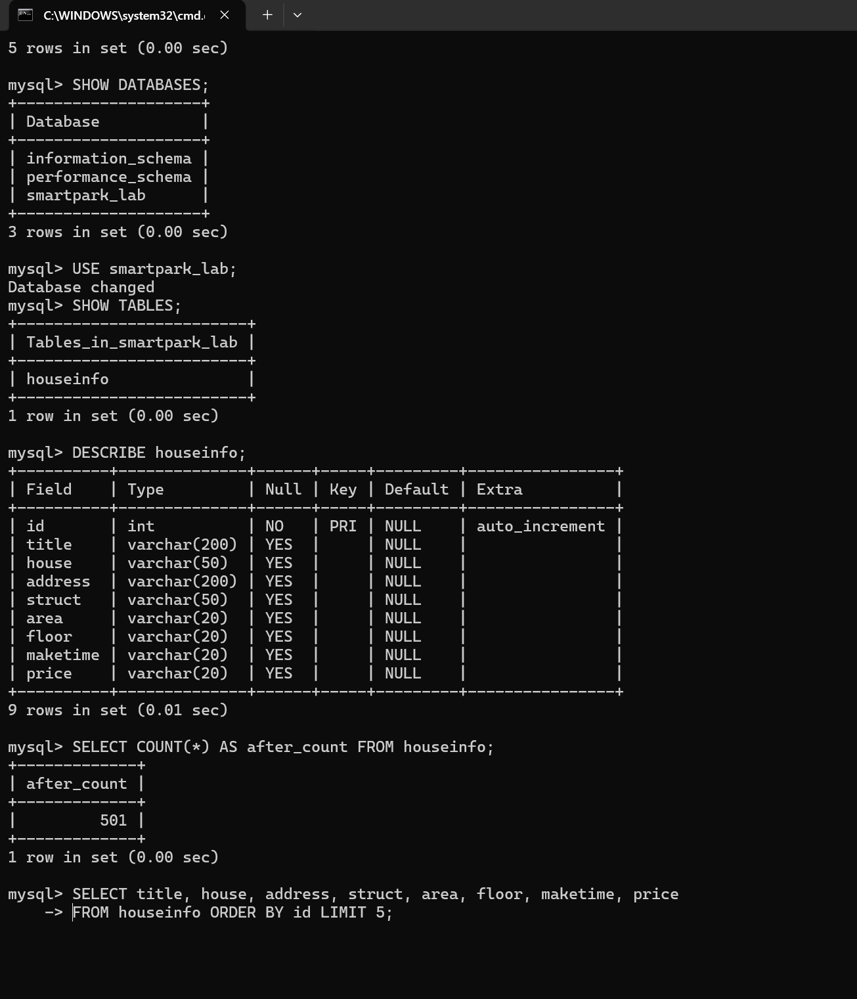

---

## 二、房源解析

### 2.1 请求与反爬处理

站点对 `User-Agent` 有校验：用简短的 `"Mozilla/5.0"` 请求会被反爬拦截，返回"访问验证"页，**状态码仍是 200 但页面里没有一条房源**。因此请求头必须带完整浏览器 UA：

```python
HEADERS = {
    "User-Agent": ("Mozilla/5.0 (Windows NT 10.0; Win64; x64) AppleWebKit/537.36 "
                   "(KHTML, like Gecko) Chrome/126.0.0.0 Safari/537.36"),
    "Accept": "text/html,application/xhtml+xml,application/xml;q=0.9,*/*;q=0.8",
    "Accept-Language": "zh-CN,zh;q=0.9",
}
r = requests.get(START_URL, headers=HEADERS, timeout=30)
r.raise_for_status()
r.encoding = r.apparent_encoding
soup = BeautifulSoup(r.text, "html.parser")
```

验证方式：打印状态码、网页标题和 `len(rows)`。实测第 1 页返回 **60 条**，标题为"重庆二手房房产网…"，说明拿到的是真实列表页而非验证页。

### 2.2 房源容器与遍历

```python
rows = soup.select("div.property")      # 一页 60 个
for row in items:                       # row 就是一条房源
    records.append(parse_one(row))
```

`div.property` = 标签 `div` 且 class 含 `property`。每条房源的外层容器是 `<div class="property">`，内部同时包含标题、楼盘、地址、属性组和价格，所以一个节点对应一条房源。框架生成的 `data-v-53a259aa` 之类属性每次构建可能变化，不能作为选择器。

### 2.3 八个字段的定位方式

| 字段 | 选择器 | 取值方式 |
|---|---|---|
| title | `h3.property-content-title-name` | `get_text(strip=True)` |
| house | `p.property-content-info-comm-name` | `get_text(strip=True)` |
| address | `p.property-content-info-comm-address` | `get_text(strip=True)`，多个 `<span>` 自动拼接，不额外插空格 |
| struct | 属性组第 1 项 | `vals[0]` |
| area | 属性组第 2 项 | `vals[1]` |
| floor | 属性组第 4 项 | `vals[3]`（第 3 项是朝向，跳过） |
| maketime | 属性组第 5 项 | `vals[4] if len(vals) > 4 else ""` |
| price | `p.property-price-average` | `get_text(strip=True)` |

### 2.4 单价为什么取到的是每平方米单价

价格区结构如下：

```html
<div class="property-price">
    <p class="property-price-total"><span class="property-price-total-num">148</span><span>万</span></p>
    <p class="property-price-average">16465元/㎡</p>
</div>
```

- `p.property-price-total` 取到 `148万`，是**整套房总价**；
- `p.property-price-average` 取到 `16465元/㎡`，`average` 即"均价"，单位是元/㎡，是**每平方米单价**；
- 二者数量级完全不同（一万六 vs 一百四十八万），对照网页价格区上下两行即可确认。

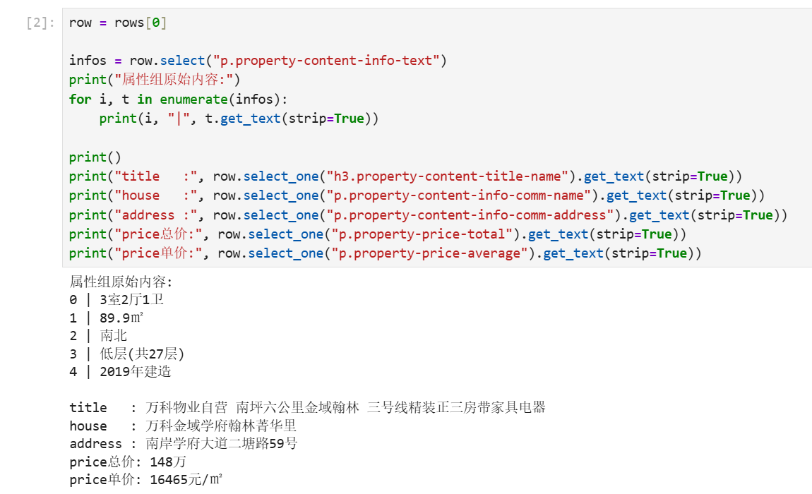

### 2.5 解析函数

```python
def parse_one(row):
    def text(sel, default=""):
        node = row.select_one(sel)
        return node.get_text(strip=True) if node else default

    title = text("h3.property-content-title-name")
    house = text("p.property-content-info-comm-name")
    address = text("p.property-content-info-comm-address")
    price = text("p.property-price-average")

    infos = row.select("p.property-content-info-text")
    vals = [t.get_text(strip=True) for t in infos]

    struct   = vals[0] if len(vals) > 0 else ""
    area     = vals[1] if len(vals) > 1 else ""
    # vals[2] 是朝向，本实验不采集
    floor    = vals[3] if len(vals) > 3 else ""
    maketime = vals[4] if len(vals) > 4 else ""

    return [title, house, address, struct, area, floor, maketime, price]
```

取值前都用 `len(vals) > n` 判长度，因为部分房源缺少"建造年代"一项，直接用固定下标会越界。

---

## 三、翻页采集

### 3.1 "下一页"节点

```python
nxt = soup.select_one("a.next.next-active")
print(nxt.get_text(strip=True))        # 下一页
print(nxt.get("href"))                 # ?page=2
print(urljoin(START_URL, nxt.get("href")))   # http://www.bspider.top/anjuke/?page=2
```

`get_text()` 只能拿到"下一页"三个字，**地址要用 `get("href")`**。href 是相对地址 `?page=2`，必须用 `urljoin(当前页 URL, href)` 补全，基准不能用首页，否则永远停在第二页。

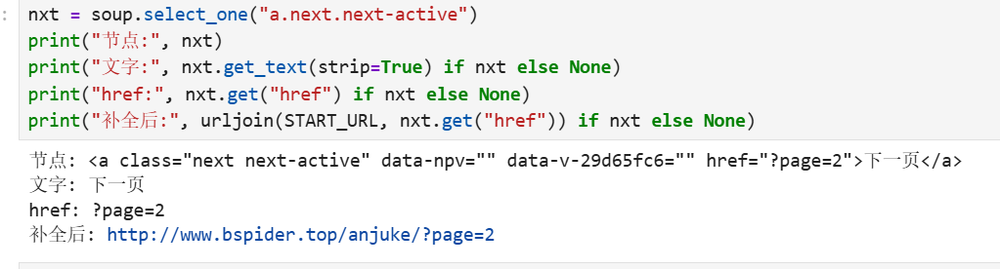

### 3.2 分页循环与停止条件

```python
records, url, visited = [], START_URL, set()

for page_no in range(1, 20):            # 安全上限，防止死循环
    resp = requests.get(url, headers=HEADERS, timeout=30)
    resp.raise_for_status()
    resp.encoding = resp.apparent_encoding
    page = BeautifulSoup(resp.text, "html.parser")

    items = page.select("div.property")
    if not items:                        # 停止条件2：本页无房源
        break
    for row in items:
        records.append(parse_one(row))
    print("第", page_no, "页", url, "本页", len(items), "条，累计", len(records), "条")

    nxt = page.select_one("a.next.next-active")
    if nxt is None:                      # 停止条件1：末页没有"下一页"按钮
        break
    nxt_url = urljoin(url, nxt.get("href"))
    if not nxt_url.startswith("http://www.bspider.top/") or nxt_url in visited:
        break                            # 停止条件3：地址越界或重复
    visited.add(url)
    url = nxt_url
    time.sleep(1)                        # 控制请求频率
```

判定到末页的依据：**分页区域仍存在，但"下一页"按钮消失**（第 10 页即如此），而不是分页区域整体消失。达到 `range` 上限只能记作"中止"，不能算采集完成。

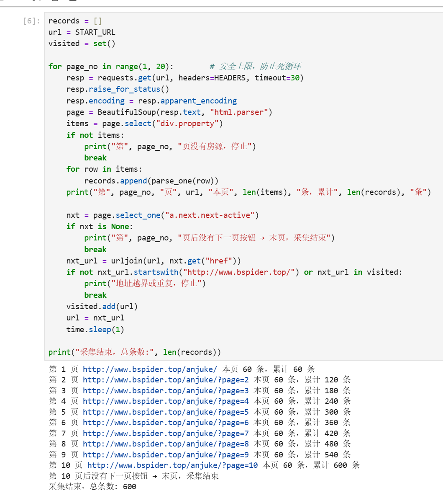

### 3.3 采集结果

| 项目 | 结果 |
|---|---|
| 每页条数 | 60 |
| 实际页数 | 10（第 10 页后无"下一页"） |
| 采集总条数 | **600** |
| 试采 2 页时与第 1 页重复数 | **0**（说明翻页真实生效） |

---

## 四、CSV 存储

### 4.1 去重

按 8 个字段组成的元组判重（站内存在完全重复的房源，多为跨页重复挂牌）：

```python
seen, unique = set(), []
for rec in records:
    key = tuple(rec)
    if key not in seen:
        seen.add(key)
        unique.append(rec)
```

**去重前 600 条 → 去重后 498 条，去掉 102 条。**

### 4.2 保存

```python
with open(out_dir / "houseinfo.csv", "w", encoding="utf-8-sig", newline="") as f:
    w = csv.writer(f)
    w.writerow(FIELDS)
    w.writerows(unique)
```

- 路径：`data/houseinfo.csv`（相对 notebook 所在的 `lab02` 目录）
- 编码 `utf-8-sig`：带 BOM，Excel 直接打开不乱码；`newline=""`：避免 Windows 下多出空行
- 表头用 `FIELDS` 写出，数据用 `writerows` 批量写入，每条正好 8 项
- 顺序保证：`parse_one()` 返回值顺序、`FIELDS` 表头顺序、`DictReader` 回读顺序三处完全一致

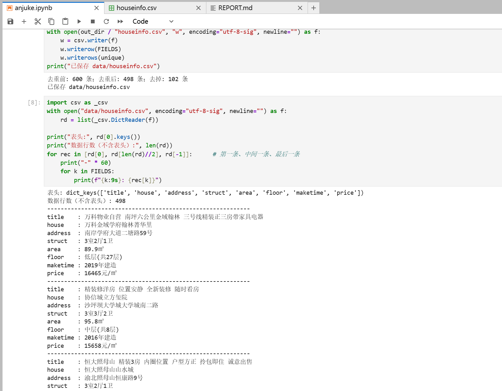

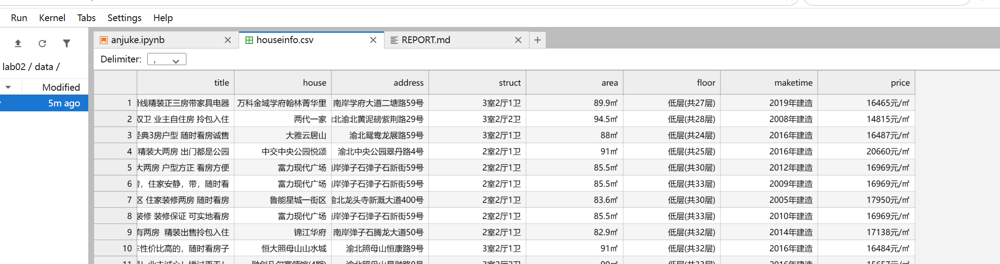

### 4.3 回读核对

```python
with open("data/houseinfo.csv", encoding="utf-8-sig", newline="") as f:
    rd = list(csv.DictReader(f))
print("数据行数（不含表头）:", len(rd))     # 498
```

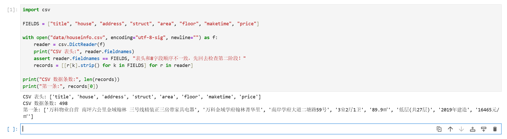

---

## 五、MySQL 批量入库

### 5.1 连接参数

| 参数 | 值 | 说明 |
|---|---|---|
| host | `mysql` | Jupyter 在容器内，`localhost` 指容器自身，必须用 Compose 服务名 |
| port | `3306` | 整数 |
| database | `smartpark_lab` | 课程教学库 |
| user / password | `student` / `123456` | 课程统一教学账号 |
| charset | `utf8mb4` | 中文正常存取 |
| autocommit | `False` | 由程序显式 commit / rollback |

```python
conn = pymysql.connect(host="mysql", port=3306, database="smartpark_lab",
                       user="student", password="123456",
                       charset="utf8mb4", autocommit=False, connect_timeout=5)
cur = conn.cursor()
cur.execute("SELECT VERSION(), DATABASE(), CURRENT_USER()")
print(cur.fetchone())        # ('8.4.11', 'smartpark_lab', 'student@%')
```

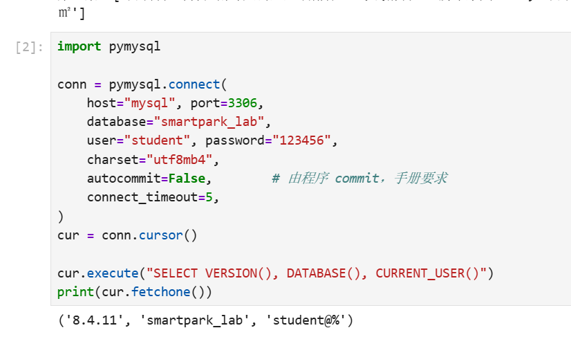

### 5.2 防重复：按 8 字段比对库内已有记录

```python
cur.execute("SELECT title,house,address,struct,area,floor,maketime,price FROM houseinfo")
existing = set(cur.fetchall())
new_records = [tuple(r) for r in records if tuple(r) not in existing]
```

自增长 `id` 不能防重复，所以按 8 个字段与库内已有记录比较，只插入尚不存在的记录；重跑时新增为 0，**不通过清空表实现重跑**。

### 5.3 批量写入

```python
sql = ("INSERT INTO houseinfo "
       "(title,house,address,struct,area,floor,maketime,price) "
       "VALUES (%s,%s,%s,%s,%s,%s,%s,%s)")
cur.executemany(sql, new_records)     # 一条 SQL 模板代入多条记录
conn.commit()
```

`executemany()` 把同一条 INSERT 模板对多条记录各执行一次，减少网络往返；8 个 `%s` 与 8 个字段**按位置一一对应**（第 1 个 ← title … 第 8 个 ← price）。参数由 PyMySQL 转义，不使用字符串拼接。

流程：先用 `new_records[:3]` 试写 3 条验证字段不串位，再全量写入剩余记录；异常时 `conn.rollback()` 撤销未提交的修改，最后 `cur.close()` → `conn.close()`。

> 试写 3 条：id 1/2/3 的 `struct`、`area`、`price` 分别为 `3室2厅1卫`、`89.9㎡`、`16465元/㎡`，确认字段对位无误。

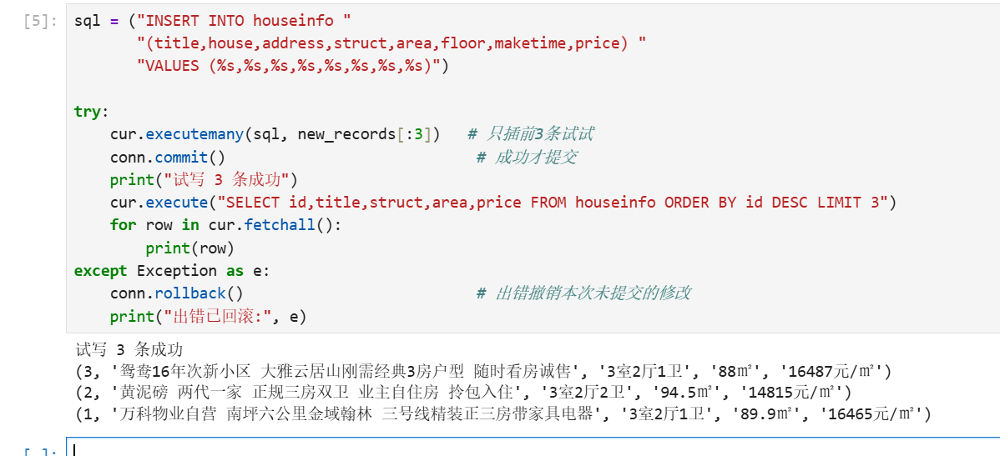

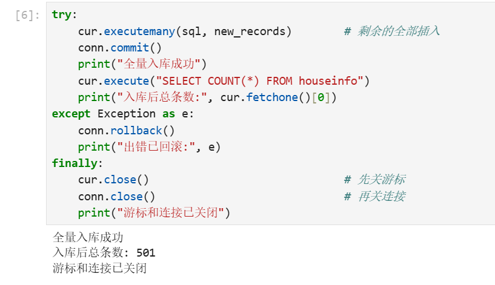

---

## 六、结果核对

### 6.1 条数对账

| 检查项 | 数值 |
|---|---:|
| 采集原始条数 | 600 |
| CSV 去重后条数 | 498 |
| 入库前 `before_count` | 0 |
| 试写 3 条 | 3 |
| 全量写入 | 498 |
| 入库后 `after_count` | **501** |
| 本次新增（501 − 0） | 501 |
| 重新运行同一批数据后待新增 | **0**（总条数仍 501） |

3 + 498 = 501，与 `after_count` 完全吻合，无丢失、无重复。

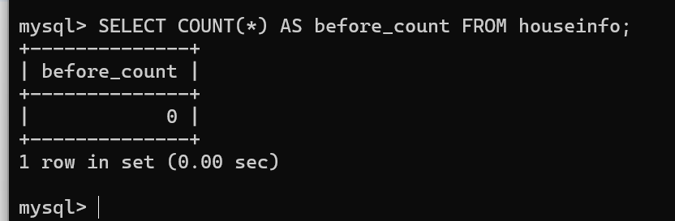

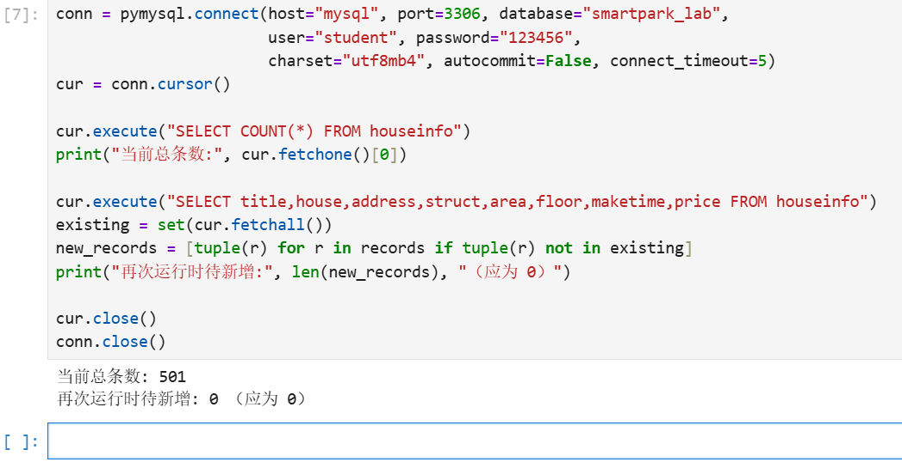

### 6.2 MySQL 终端验收

```sql
SHOW DATABASES;
USE smartpark_lab;
SHOW TABLES;
DESCRIBE houseinfo;
SELECT COUNT(*) AS after_count FROM houseinfo;
SELECT title, house, address, struct, area, floor, maketime, price
FROM houseinfo ORDER BY id LIMIT 5;
```

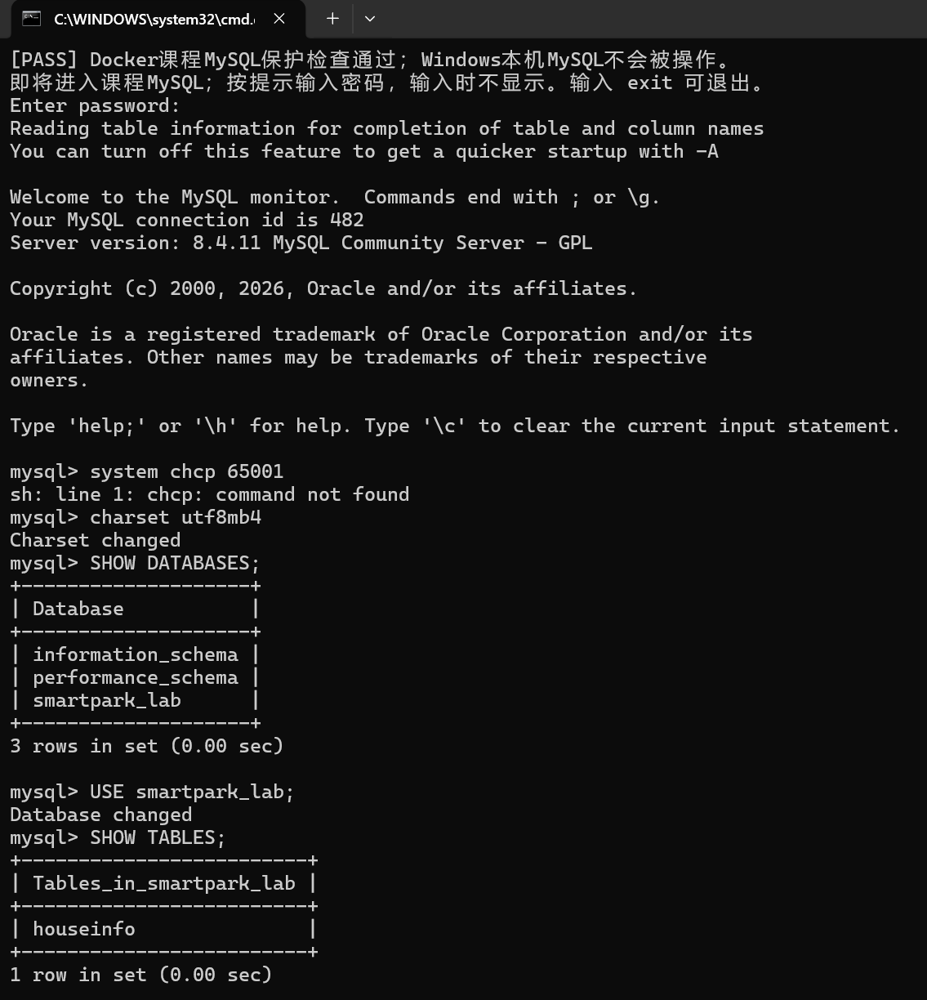

> 说明：Windows 命令行的 mysql 客户端默认字符集不匹配，中文会显示为 `?`；执行 `charset utf8mb4;` 后显示恢复正常（截图 08），数据库内实际存储一直正确（PyMySQL 端查询中文正常）。

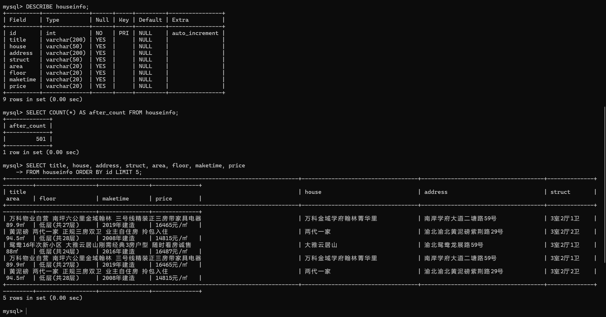

### 6.3 逐字段核对（CSV 第 1 条 vs 数据库 id=1）

| 字段 | CSV | 数据库 |
|---|---|---|
| title | 万科物业自营 南坪六公里金域翰林 三号线精装正三房带家具电器 | 一致 |
| house | 万科金域学府翰林菁华里 | 一致 |
| address | 南岸学府大道二塘路59号 | 一致 |
| struct | 3室2厅1卫 | 一致 |
| area | 89.9㎡ | 一致 |
| floor | 低层(共27层) | 一致 |
| maketime | 2019年建造 | 一致 |
| price | 16465元/㎡ | 一致 |

---

## 七、思考题

**1. 下一页是怎样取得的？结合代码解释 href、urljoin 和停止条件。**

答：用 `page.select_one("a.next.next-active")` 定位"下一页"按钮，`nxt.get("href")` 取到相对地址 `?page=2`，再用 `urljoin(url, nxt.get("href"))` 以**当前页地址**为基准补全成绝对地址，循环末尾 `url = nxt_url` 更新请求地址。停止条件有四道：① 找不到"下一页"按钮（末页，正常结束，本站为第 10 页后）；② 本页解析不到任何房源（异常）；③ 补全后的地址越出教学站域名或已在 `visited` 中出现（越界/重复）；④ 达到 `range(1, 20)` 安全上限（只能记中止）。

**2. 旧代码把 out_list 定义在全局。你把结果列表放在哪里？为什么？**

答：放在采集函数/单元内部，并在每轮采集开始时用 `records = []` 重新初始化。原因是全局列表在重复运行单元时会不断累积，同一批数据被追加多次，造成条数虚高、重复入库；放在局部并重置后，每次运行都是干净的一批结果。同时 `parse_one(row)` 只依赖传入的 `row`，不读写任何全局变量，便于单条调试和复用。

**3. 你怎样获取建造年代？节点缺失或顺序改变时，怎样处理？**

答：建造年代是属性组的第 5 个 `p.property-content-info-text`，先 `row.select(...)` 取出全部属性项转成列表 `vals`，再用 `vals[4] if len(vals) > 4 else ""` 取值——先判长度再取下标，缺失时填空字符串而不是报错。为避免"朝向被当楼层"这类错位，取值前先打印整个属性组的编号内容确认顺序（0 户型、1 面积、2 朝向、3 楼层、4 年代）。如果站点将来调整顺序，则需重新核对结构；更稳妥的写法是按内容特征匹配（例如取文本中含"年建造"的项），而不是依赖固定下标。
